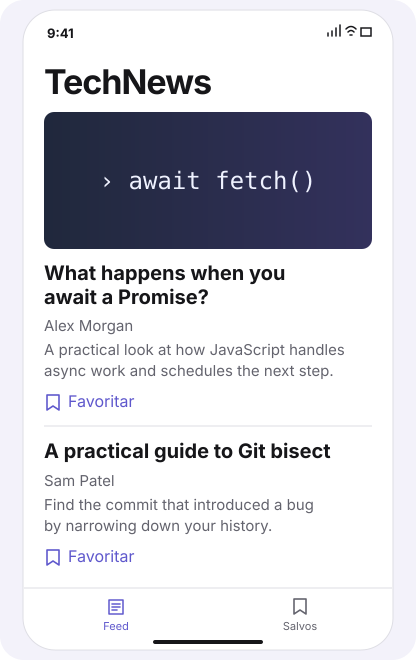
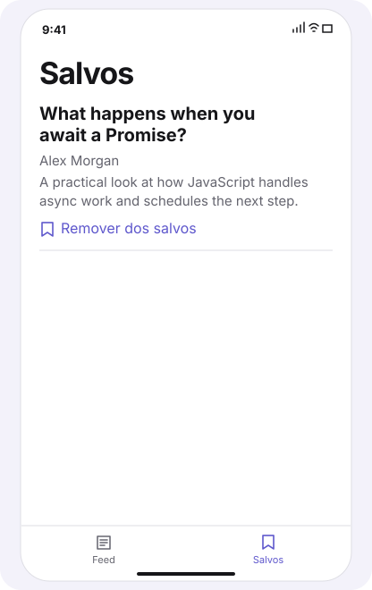
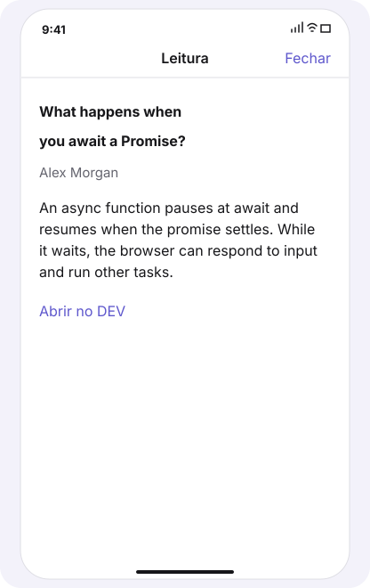

# TechNews

Leitor nativo de artigos de programação do DEV Community. O app usa SwiftUI, arquitetura MVVM e a API pública do Dev.to, sem chave de API ou dependências externas.

## Prévia da interface

| Feed | Salvos | Leitura |
| --- | --- | --- |
|  |  |  |

As imagens representam a interface com artigos de exemplo. A execução do app nativo no iOS está pendente de validação.

Para explorar a demo, abra `docs/index.html` no navegador. A página permite favoritar, remover e ler artigos de exemplo. Para compartilhar um endereço público, publique a pasta `docs` com o GitHub Pages e adicione o endereço publicado ao portfólio.

## Executar

**Xcode no Mac.** Abra `TechNews.xcodeproj`, escolha o esquema TechNews e execute em um simulador com iOS 16 ou posterior. Para instalar em um iPhone, selecione sua equipe em **Signing & Capabilities** e escolha o dispositivo como destino. Se a assinatura pedir um identificador exclusivo, ajuste o **Bundle Identifier**.

**Swift Playgrounds no iPad ou Mac.** Crie um playground do tipo **App** e substitua os arquivos Swift de exemplo por `TechNews.swift`. O arquivo já inclui o ponto de entrada `@main`.

## Fluxo do aplicativo

- **Feed.** A lista mostra capa, título, autor e resumo. Puxe a lista para atualizar e toque no título para abrir a leitura.
- **Salvos.** Ao favoritar, o aplicativo baixa o texto antes de gravar o artigo no dispositivo. Abra a aba Salvos para ler o texto sem conexão ou remover o favorito. Capas e imagens externas dependem de rede.
- **Leitura.** O leitor exibe o texto com formatação Markdown inline e oferece um link para o artigo original.

## Arquitetura

O código do app fica em `TechNews.swift`. O modelo `Article` mapeia o JSON da API. `DevAPI` faz as requisições com `URLSession` e `async/await`. `NewsViewModel` coordena o feed e os favoritos, e `ReaderViewModel` gerencia o carregamento do texto. As views observam esses estados. `FavoritesStore` codifica o array de artigos em JSON no `UserDefaults`.

## Teste manual

1. Abra o feed com conexão e toque em um título para ler o artigo.
2. Volte ao feed, favorite o artigo e espere o término do download.
3. Encerre o app, desative a conexão e reabra o app. Abra **Salvos** e verifique se o artigo completo pode ser lido.
4. Remova o favorito e reabra o app para conferir se a remoção persistiu.
5. Com a rede desativada, abra o feed. Reconecte e use **Tentar novamente**.
